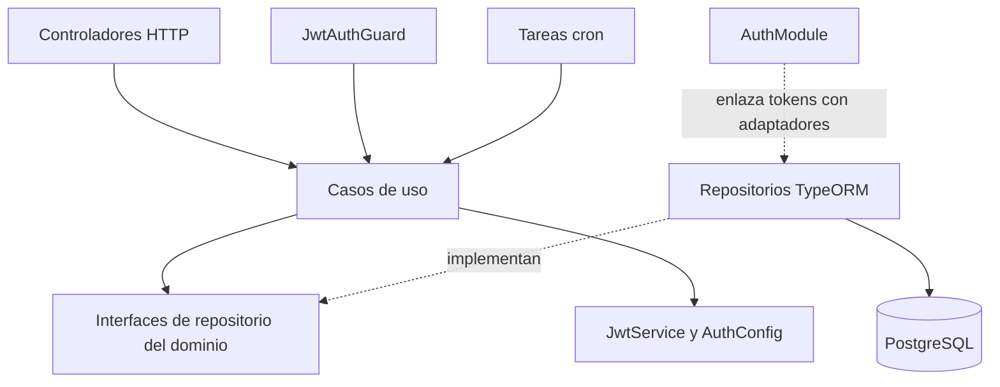

# Arquitectura del módulo Auth

Auth organiza la autenticación, las sesiones y la autorización por permisos en
capas inspiradas en DDD. Separa los contratos del dominio, los casos de uso,
la persistencia y la API HTTP. Este documento describe la estructura existente,
incluidos sus acoplamientos; no presupone una implementación de DDD estricta.

Para los flujos de tokens consulta [Autenticación](authentication.md). Para
configuración e integración consulta el [README del módulo](../README.md).

## Estructura

```text
auth/
├── domain/
│   ├── models/                      # Contratos de usuario, sesión y refresh
│   └── repositories/                # Interfaces de persistencia
├── application/
│   ├── use-cases/                   # Operaciones de autenticación y sesiones
│   └── dto/                         # Representación del usuario
├── infrastructure/
│   ├── persistence/typeorm/
│   │   ├── entities/                # Mapeo relacional
│   │   ├── repositories/            # Adaptadores de persistencia
│   │   ├── migrations/              # Esquema y datos iniciales
│   │   └── enums/                   # Códigos de opciones/permisos
│   ├── guards/                      # Acceso HTTP y permisos
│   ├── decorators/                  # Metadatos de permisos
│   ├── strategies/                  # Integración con Passport JWT
│   └── utils/                       # Hash y generación de JTI
├── presentation/
│   ├── controllers/                 # Endpoints y documentación Swagger
│   └── dto/                         # Entradas HTTP y respuesta de tokens
├── jobs/                            # Adaptadores del planificador
├── auth.module.ts                   # Composición e inyección de dependencias
├── auth.config.ts                   # Acceso a configuración y esquema Joi
├── auth.config.module.ts            # Proveedor de configuración
├── auth.constants.ts                # Nombre de conexión
└── docs/                            # Documentación del módulo
```

Las pruebas `.spec.ts` se ubican junto a las clases que verifican.

## Dominio: contratos del negocio

`domain` define el vocabulario compartido por los casos de uso y los adaptadores:

| Contrato                  | Responsabilidad                                                                                     |
| ------------------------- | --------------------------------------------------------------------------------------------------- |
| `IUser`                   | Identidad, estado, perfil y permisos del usuario.                                                   |
| `ISession`                | Asociación de usuario, JTI y expiración de una sesión.                                              |
| `IRefreshToken`           | Asociación de usuario, JTI y expiración para renovar tokens.                                        |
| `IUserRepository`         | Consultar usuarios por identidad, credenciales o estado activo.                                     |
| `ISessionRepository`      | Consultar y revocar sesiones, y coordinar operaciones persistentes sobre sesiones y refresh tokens. |
| `IRefreshTokenRepository` | Consultar refresh tokens por JTI y eliminar los expirados.                                          |

Estos archivos contienen interfaces TypeScript, sin decoradores NestJS o
TypeORM. No hay actualmente agregados, value objects, eventos de dominio ni
entidades con comportamiento propio en esta capa. Las reglas operativas están
principalmente en los casos de uso y parte del mapeo en los repositorios.

Las clases llamadas `UserEntity`, `SessionEntity`, etc. pertenecen a
infraestructura: son entidades de persistencia, no objetos de dominio ricos.

## Aplicación: coordinación de casos de uso

`application/use-cases` implementa las operaciones que pueden solicitar los
controladores, guards o tareas programadas:

| Caso de uso                         | Responsabilidad                                                                                  |
| ----------------------------------- | ------------------------------------------------------------------------------------------------ |
| `LoginUseCase`                      | Validar credenciales y estado del usuario, emitir tokens y solicitar su persistencia.            |
| `RefreshTokenUseCase`               | Verificar la renovación, comprobar usuario y registro de refresh, y reemplazar el par de tokens. |
| `ValidateTokenUseCase`              | Verificar access token y recuperar la sesión y el usuario activo.                                |
| `GetUsertUseCase`                   | Transformar el usuario recibido a `UserDto`; este es el nombre actual de la clase.               |
| `GetSessionsUseCase`                | Consultar las sesiones del usuario.                                                              |
| `LogoutUseCase`                     | Localizar la sesión actual y eliminarla junto con su refresh token.                              |
| `LogoutAllUseCase`                  | Obtener el usuario de la sesión actual y solicitar el cierre de sus sesiones y refresh tokens.   |
| `RevokeSessionUseCase`              | Solicitar la revocación de una sesión por identificador.                                         |
| `DeleteExpiredSessionsUseCase`      | Delegar la limpieza de sesiones expiradas.                                                       |
| `DeleteExpiredRefreshTokensUseCase` | Delegar la limpieza de refresh tokens expirados.                                                 |

Los casos de uso consumen las interfaces de repositorio y trabajan con modelos
de dominio. No construyen consultas SQL ni acceden a `EntityManager`.
`application/dto/UserDto` implementa `IUser` y declara propiedades con `@Expose`
para su transformación con `class-transformer`.

Los errores operativos se expresan generalmente mediante `UseCaseError` y
`ErrorLevel`. Login y refresh, por ejemplo, distinguen usuario inexistente o
inactivo de fallos inesperados. La traducción exacta a HTTP corresponde a los
adaptadores y se detalla en [Autenticación](authentication.md).

## Infraestructura: persistencia y adaptadores técnicos

### Persistencia TypeORM

Los repositorios implementan los contratos del dominio mediante PostgreSQL:

| Clase                    | Responsabilidad                                                                                                      |
| ------------------------ | -------------------------------------------------------------------------------------------------------------------- |
| `UserRepository`         | Buscar usuarios, calcular el hash para la consulta por credenciales y mapear usuario/perfil/opciones a `IUser`.      |
| `SessionRepository`      | Consultar y mapear sesiones; ejecutar transacciones de creación, rotación y revocación junto con los refresh tokens. |
| `RefreshTokenRepository` | Buscar, crear y eliminar registros de renovación, usando un administrador transaccional cuando se proporciona.       |
| `OptionRepository`       | Consultar opciones y opciones activas para resolver permisos.                                                        |
| `TypeOrmRepository`      | Conservar y exponer el `DataSource` inyectado a sus subclases.                                                       |

`UserRepository` depende además de `OptionRepository`; `SessionRepository`
depende de `RefreshTokenRepository`. Estas colaboraciones permanecen dentro de
infraestructura. Los modelos devueltos por los contratos no exponen las
relaciones TypeORM ni necesitan mantener una entidad conectada a la base de datos.

Las transacciones pertenecen al adaptador de persistencia. Por ejemplo,
`saveSessionAndRefreshToken` elimina el JTI anterior, si existe, y guarda ambos
registros nuevos utilizando el mismo `EntityManager`. El caso de uso solicita
esa operación a través de `ISessionRepository`.

Las seis entidades representan usuarios, perfiles, opciones, asociaciones de
perfil/opción, sesiones y refresh tokens. Las migraciones crean el esquema y
los datos iniciales. `OptionCode` enumera los permisos incluidos por esa carga.

### Autenticación y autorización

- `JwtAuthGuard` adapta el encabezado HTTP Bearer a `ValidateTokenUseCase` y
  adjunta usuario, sesión y trazabilidad a la solicitud.
- `PermissionsGuard` lee los permisos requeridos mediante `Reflector` y
  comprueba que el usuario tenga todos ellos.
- `Permissions` declara esos requisitos como metadatos del controlador o método.
- `JwtStrategy` configura la integración Passport JWT. Los controladores
  actuales usan el guard propio, que llama al caso de uso; no delegan su flujo
  de validación a esta estrategia.
- `Utils` contiene utilidades técnicas de hashing y generación de JTI. Algunas
  operaciones, como el hash de credenciales en `UserRepository`, utilizan las
  utilidades equivalentes del módulo Shared.

## Presentación: contrato HTTP

`presentation/controllers` define rutas bajo `/api/v1/auth`, extrae cuerpos y
parámetros, llama a los casos de uso y construye respuestas HTTP.

- `LoginController` y `RefreshController` reciben credenciales o refresh tokens.
- `MeController` expone el usuario autenticado.
- `SessionController` lista y revoca sesiones.
- `LogoutController` cierra la sesión actual o todas las del usuario.

Los DTO `LoginDto` y `RefreshTokenDto` declaran validaciones de entrada que
ejecuta el `ValidationPipe` global. `AccessDto` representa el par de tokens de
salida. Los decoradores Swagger describen operaciones, esquemas y autenticación.

Los controladores utilizan `ResponseDto` y `CommonController` de Shared cuando
corresponde. Las operaciones de eliminación devuelven 204 sin cuerpo. La
presentación no debe incorporar consultas SQL ni gestionar transacciones.

## Jobs: entrada desde el planificador

`DeleteExpiredSessionsCron` y `DeleteExpiredRefreshTokensCron` son adaptadores
de entrada alternativos a HTTP. Generan un `logId`, invocan el caso de uso de
limpieza cada minuto y registran los errores del proceso.

El criterio de eliminación se implementa en los repositorios. Las tareas no
construyen consultas ni dependen de los controladores.

## Composición y configuración

`AuthModule` conecta los elementos del módulo:

- Configura JWT, Passport, el planificador y la conexión PostgreSQL.
- Registra entidades, controladores, guards, casos de uso y tareas.
- Asocia tokens de inyección con implementaciones concretas:

| Token                     | Implementación           |
| ------------------------- | ------------------------ |
| `USER_REPOSITORY`         | `UserRepository`         |
| `SESSION_REPOSITORY`      | `SessionRepository`      |
| `REFRESHTOKEN_REPOSITORY` | `RefreshTokenRepository` |

Las interfaces se eliminan al compilar TypeScript; los símbolos permiten
resolver sus implementaciones en tiempo de ejecución mediante `@Inject`.

El módulo exporta `JwtAuthGuard` y `ValidateTokenUseCase`. `PermissionsGuard`
existe en infraestructura, pero actualmente no está registrado ni exportado
por Auth: un consumidor que lo utilice debe registrarlo en su módulo.

`AuthConfigModule` provee `AuthConfig`. La carga y validación global del entorno
se realiza en `AppConfigModule`, fuera de Auth, que integra `authConfigSchema`.
`AUTH_CONNECTION_NAME` identifica la conexión usada por los repositorios.

## Flujo entre capas

El siguiente diagrama representa llamadas y uso de contratos, no una garantía
de aislamiento de todos los imports:



Por ejemplo, al iniciar sesión el controlador recibe `LoginDto`, el caso de
uso consulta `IUserRepository`, el adaptador devuelve `IUser`, y la aplicación
firma los tokens y solicita a `ISessionRepository` guardarlos. El controlador
envuelve el resultado en la respuesta HTTP.

## Acoplamientos actuales y criterios de evolución

La separación por carpetas facilita localizar responsabilidades, pero existen
dependencias que atraviesan los límites habituales de DDD:

- Los símbolos de repositorio se declaran en los archivos concretos TypeORM.
  Los casos de uso los importan desde infraestructura para su inyección.
- Login y refresh dependen directamente de `JwtService`, `AuthConfig` y
  utilidades técnicas; la emisión de tokens no está abstraída mediante un puerto.
- Algunos casos de uso importan DTO de `presentation`, como `LoginDto` y
  `AccessDto`, por lo que aplicación también conoce parte del contrato HTTP.
- Los casos de uso emplean decoradores y logging NestJS. No son clases
  completamente independientes del framework.
- El dominio contiene contratos de datos; las invariantes no están encapsuladas
  en agregados. `ISessionRepository` concentra operaciones que afectan dos tablas.

Al ampliar el módulo, conserva los contratos de dominio libres de detalles HTTP
y TypeORM, coloca la coordinación en casos de uso y deja persistencia y
transacciones en sus adaptadores. Si se requiere mayor independencia, se pueden
separar los tokens de sus implementaciones, definir puertos para JWT y distinguir
los DTO de aplicación de los HTTP. Estas son opciones de evolución, no cambios
ya implementados.

## Pruebas por responsabilidad

- Casos de uso: reglas, resultados, errores y llamadas a repositorios o JWT simulados.
- Controladores y guards: parámetros, contexto de solicitud y respuestas HTTP.
- Repositorios: consultas, mapeo y coordinación transaccional con mocks de TypeORM.
- Migraciones y entidades: operaciones de esquema y metadatos de persistencia.
- DTO: validaciones y transformaciones declaradas.
- Jobs: delegación y manejo de fallos sin ejecutar un planificador real.
- Módulo y configuración: factories, proveedores y variables requeridas.

Estas pruebas no requieren una base de datos real. La ejecución de SQL y el
comportamiento real de las transacciones requieren pruebas de integración.
