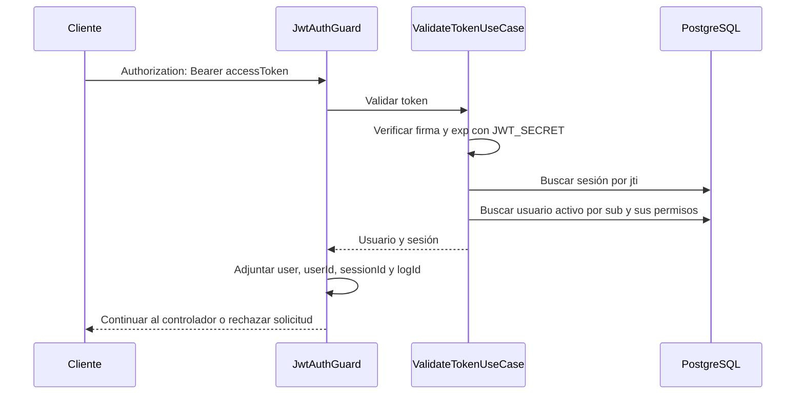

# JWT, sesiones, refresh tokens y revocación

Este documento describe la implementación actual de Auth. Para integrar el
módulo y configurar PostgreSQL y los secretos, consulta el [README](../README.md).
Las rutas usan el prefijo `/api/v1/auth` y están documentadas en `/swagger`.

## Modelo de autenticación

Auth combina JWT firmados con registros persistidos en PostgreSQL. Un access
token válido no es suficiente: también debe existir su sesión y el usuario debe
estar activo. Esta consulta permite rechazar tokens revocados antes de su
expiración criptográfica.

| Elemento            | Finalidad                                                                  | Identificación y duración                                                      |
| ------------------- | -------------------------------------------------------------------------- | ------------------------------------------------------------------------------ |
| Access token        | Acceder a rutas protegidas mediante `Authorization: Bearer <accessToken>`. | Firma con `JWT_SECRET`; duración `JWT_EXPIRESIN`, en segundos.                 |
| Refresh token       | Solicitar un nuevo par de tokens mediante `POST /refresh`.                 | Firma con `JWT_REFRESH_SECRET`; duración `JWT_REFRESH_EXPIRESIN`, en segundos. |
| Sesión              | Mantener el registro servidor asociado al access token.                    | `sessionId`, `userId`, `jti` y `expiresAt`.                                    |
| Registro de refresh | Comprobar que la renovación sigue autorizada.                              | `refreshTokenId`, `userId`, `jti` y `expiresAt`.                               |

Cada par emitido comparte un `jti`, generado con `randomUUID()`. El `sessionId`
identifica la fila de sesión; el `jti` relaciona ambos JWT con los registros de
sesión y renovación. No son el mismo identificador.

Las tablas son `auth_trn_user_session` y `auth_trn_user_refresh_token`. Se guarda
el identificador y la expiración, no la cadena completa de los JWT.

## Contenido y verificación de los JWT

Los dos tokens llevan los siguientes datos:

```json
{
  "displayName": "Usuario",
  "sub": "identificador-del-usuario",
  "jti": "identificador-del-par-de-tokens"
}
```

La librería JWT agrega los tiempos de emisión y expiración (`iat` y `exp`). La
expiración se expresa en segundos Unix; el código la convierte a una fecha con
`new Date(exp * 1000)` para persistirla.

El JWT está firmado, no cifrado: su contenido puede leerse sin conocer el
secreto. `decode()` permite leerlo, pero no valida su autenticidad. Auth utiliza
`verify()` para verificar firma y expiración antes de aceptar un token recibido.
Los permisos se consultan desde la base de datos; no se incluyen en el JWT.

La separación entre access y refresh depende de los secretos configurados y del
registro consultado. El payload actual no incluye una marca de tipo de token;
configura secretos distintos para ambos usos.

## Inicio de sesión

`POST /login` recibe:

```json
{
  "email": "usuario@example.com",
  "password": "clave"
}
```

`LoginUseCase` realiza estos pasos:

1. Busca el usuario por correo y hash de contraseña. El repositorio calcula
   actualmente SHA-256 de la contraseña recibida.
2. Rechaza usuarios inexistentes o inactivos.
3. Genera un `jti` y firma los tokens con sus respectivos secretos y duraciones.
4. Construye la sesión con la expiración del access token y el registro de
   refresh con la expiración del refresh token.
5. Guarda ambos registros en una transacción y devuelve el par de tokens.

Cada login crea una sesión independiente, por lo que un usuario puede tener
varias sesiones simultáneas. La respuesta HTTP 200 utiliza `ResponseDto`:

```json
{
  "statusCode": 200,
  "logId": "12345678",
  "message": "login successful",
  "data": {
    "accessToken": "<accessToken>",
    "refreshToken": "<refreshToken>"
  }
}
```

## Acceso a rutas protegidas

`JwtAuthGuard` procesa el encabezado Bearer y delega en `ValidateTokenUseCase`:



La validación no compara explícitamente `session.expiresAt` con la hora actual:
la expiración de acceso se comprueba en el JWT. La búsqueda de sesión confirma
que el registro siga existiendo.

`GET /me` devuelve el usuario y sus permisos. `GET /sessions` consulta las filas
de sesión del usuario autenticado. Esa consulta no filtra por fecha, por lo que
puede incluir filas expiradas todavía pendientes de limpieza.

Los controladores actuales utilizan `JwtAuthGuard`. Aunque el módulo registra
`JwtStrategy`, la validación de estas rutas pasa por `ValidateTokenUseCase`.
La autorización por permisos es un paso separado mediante `PermissionsGuard`.

## Renovación y rotación

`POST /refresh` recibe el refresh token en el cuerpo; no requiere un access
token válido ni el encabezado Bearer:

```json
{
  "token": "<refreshToken>"
}
```

`RefreshTokenUseCase`:

1. Verifica firma y expiración con `JWT_REFRESH_SECRET`.
2. Obtiene el `jti` y busca su registro de refresh en la base de datos.
3. Carga el usuario indicado por ese registro y verifica que esté activo.
4. Genera un nuevo `jti` y un nuevo par de tokens.
5. Dentro de una transacción, elimina los registros del `jti` anterior y crea
   la nueva sesión y el nuevo registro de refresh.
6. Devuelve HTTP 200 con `data.accessToken` y `data.refreshToken`.

El cliente debe reemplazar ambos tokens. La rotación también crea una nueva
fila de sesión, por lo que cambia el `sessionId`. Una vez completada, el access
token anterior deja de encontrar su sesión y el refresh anterior deja de
encontrar su registro, aunque aún no hayan alcanzado su fecha de expiración.

Renovar no requiere encontrar la sesión anterior. Por eso puede realizarse
después de que expire el access token o se limpie su sesión, siempre que el
refresh token siga siendo válido, su registro exista y el usuario esté activo.

La lectura del registro de refresh ocurre antes de la transacción de reemplazo.
No hay bloqueo explícito, consumo condicional ni seguimiento de familias de
tokens: la implementación no garantiza un único ganador ante renovaciones
simultáneas del mismo token. La eliminación impide su reutilización posterior
en el flujo secuencial, pero no constituye detección de reutilización concurrente.

## Revocación y cierre de sesiones

| Operación                     | Selección                                | Efecto                                                   |
| ----------------------------- | ---------------------------------------- | -------------------------------------------------------- |
| `POST /logout`                | `sessionId` agregado por el guard.       | Elimina la sesión y el refresh con su mismo `jti`.       |
| `POST /logout-all`            | Usuario obtenido desde la sesión actual. | Elimina sus sesiones y registros de refresh.             |
| `DELETE /sessions/:sessionId` | Identificador recibido en la ruta.       | Busca la sesión y elimina sesión y refresh por su `jti`. |

Las eliminaciones de cada operación se ejecutan dentro de una transacción.
Las tres rutas requieren un access token válido y devuelven 204 sin cuerpo.
Si la sesión indicada en DELETE no existe, el repositorio termina sin eliminar
registros y el controlador devuelve igualmente 204.

La revocación no altera la firma ni el `exp` de un JWT ya emitido. El servidor
lo rechaza en validaciones posteriores porque falta su registro. No cancela
retroactivamente solicitudes que ya superaron el guard.

La ruta DELETE actual no verifica que la sesión objetivo pertenezca al usuario
autenticado. `RevokeSessionUseCase` recibe `sessionId` y `logId`, sin `userId`;
por tanto, autenticación y comprobación de propiedad no son equivalentes aquí.

Logout requiere autenticación vigente. Si solo queda un refresh token válido,
el cliente puede renovar y después cerrar la nueva sesión. Eliminar tokens
del cliente por sí solo no elimina los registros del servidor.

## Expiración y limpieza

Hay dos tareas independientes que se ejecutan cada minuto:

- `DeleteExpiredSessionsCron`: elimina sesiones con `expires_at <= now()`.
- `DeleteExpiredRefreshTokensCron`: elimina registros de refresh con el mismo
  criterio sobre su propia tabla.

La limpieza de sesiones no elimina automáticamente los refresh tokens: sus
duraciones son independientes. La verificación de `exp` rechaza JWT expirados
sin esperar a que se ejecute la siguiente limpieza.

Cada tarea usa `waitForCompletion: true` y registra los errores sin propagarlos
al planificador. Esto evita solapamientos de esa tarea dentro de una instancia;
no es un bloqueo distribuido entre varias réplicas.

## Errores HTTP de la implementación actual

| Situación                                                                | Resultado                                               |
| ------------------------------------------------------------------------ | ------------------------------------------------------- |
| Login con usuario inexistente o inactivo                                 | 400.                                                    |
| Datos de entrada inválidos según los DTO y el `ValidationPipe` global    | 400.                                                    |
| Encabezado Bearer ausente o incorrecto                                   | 401.                                                    |
| Access token inválido o expirado, sesión ausente o usuario sin actividad | 401.                                                    |
| Refresh verificado, pero sin registro o sin usuario activo               | 400.                                                    |
| Fallo de verificación JWT durante refresh, incluida expiración           | 500: el caso de uso lo envuelve como error desconocido. |
| Fallo dentro de los controladores de logout o sesiones                   | 500.                                                    |

El guard convierte cualquier `UseCaseError` recibido en 401, incluso los que
`ValidateTokenUseCase` haya marcado como desconocidos por un fallo de
persistencia. Solo su rama de errores no reconocidos produce 500. Esta tabla
describe el comportamiento existente, no una normalización adicional de errores.

## Código relacionado

- [Login](../application/use-cases/login.use-case.ts).
- [Validación de acceso](../application/use-cases/validateToken.use-case.ts) y
  [guard JWT](../infrastructure/guards/jwt.authguard.ts).
- [Renovación](../application/use-cases/refreshToken.use-case.ts).
- [Persistencia y transacciones de sesiones](../infrastructure/persistence/typeorm/repositories/session.repository.ts).
- [Persistencia de refresh tokens](../infrastructure/persistence/typeorm/repositories/refreshToken.repository.ts).
- [Configuración](../auth.config.ts).
